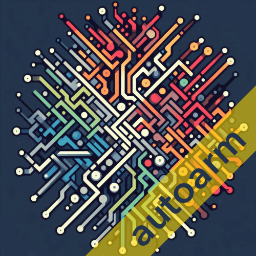
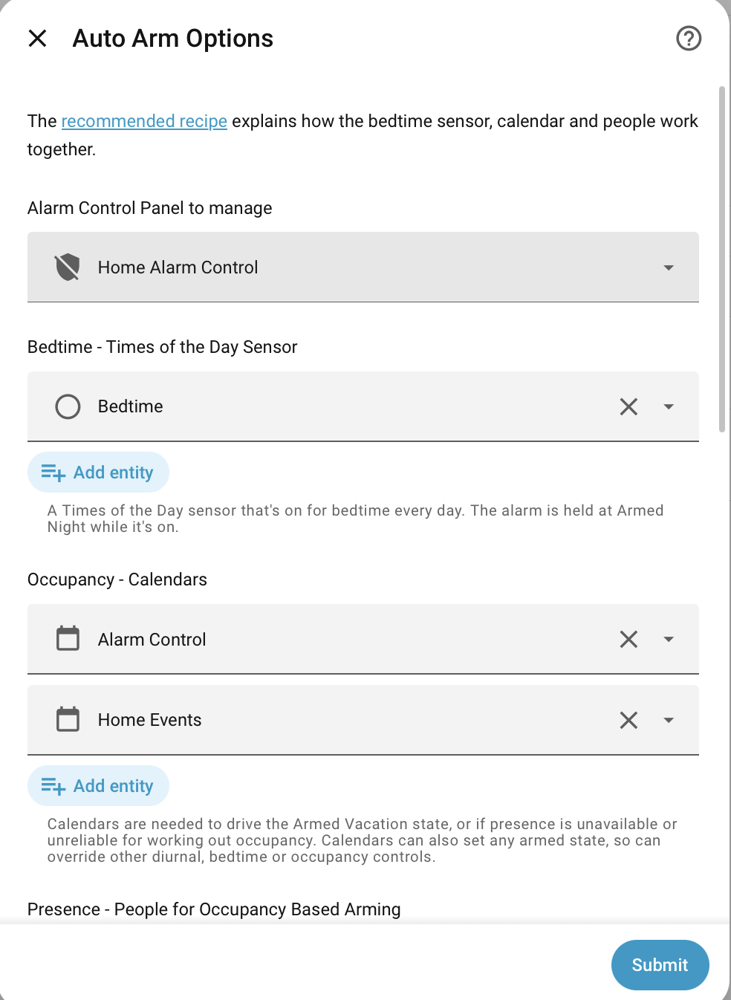
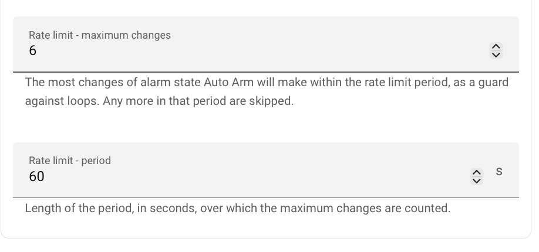
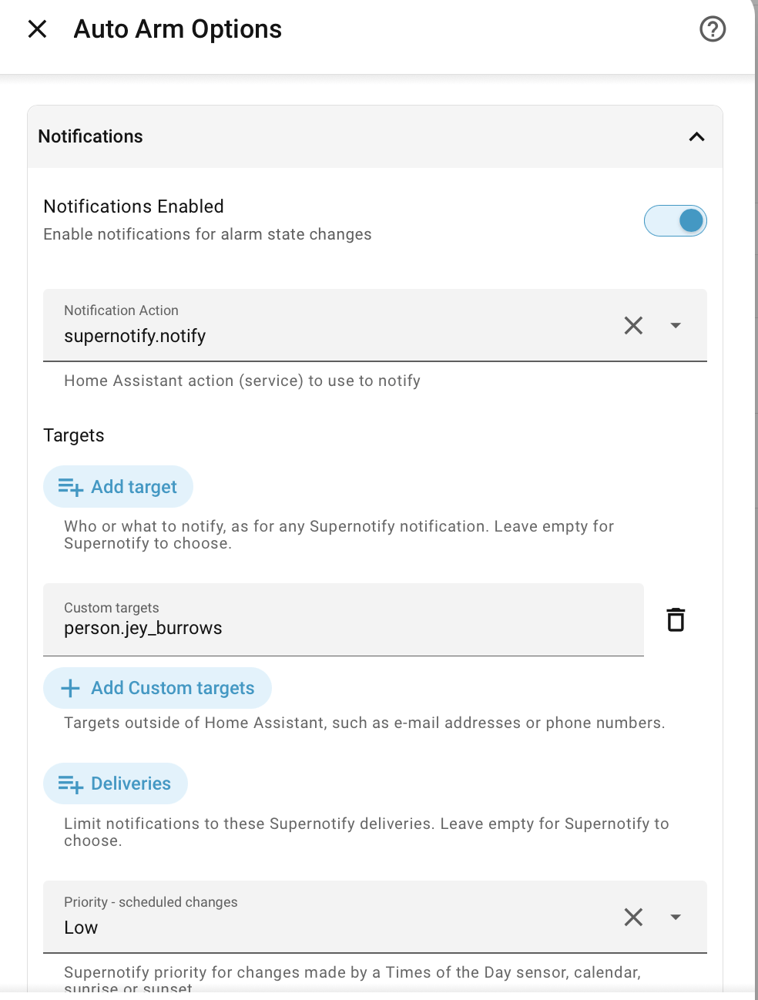

{ align=left }

# Alarm Auto Arming

 [![hacs][hacsbadge]][hacs]

 
 
 

Automate the arming and disarming of the built-in Home Assistant [Alarm
Control Panel Integrations][], with additional support for calendar integration, occupancy-driven arming and disarming, manual override via remote control buttons, and mobile push actionable notifications.

Calendar, occupancy, physical buttons, diurnal and bedtime scheduling available with **zero YAML**, support for 11 languages, and everything configured from the Home Assistant settings. Advanced configuration for transition logic, and fine-tuning for notifications and other scheduling, available from optional YAML configuration.

!!! question inline end "Why use alarm control panels?"
    A (virtual) [Manual Control Panel](https://www.home-assistant.io/integrations/manual/) is useful, even if there is no real alarm system, as a **single central state of the home**, and then use that to drive automations, notifications etc rather than littering notifications with checks for presence, time of day, vacations or similar.

    For example, it is likely that many things will change if `ARMED_VACATION` applies, and you may want to have all PIR alerts silenced if alarm state is `DISARMED`. This builds on how real alarm systems have worked for decades.

    One big obstacle to using Alarm Control Panel is having to remember to change the alarm panel state when people are in or out of the house, at night or when away on holiday.
    *Auto Arm* solves that problem, and makes the Alarm Control Panel essential for any well-automated home.

## Setup

Auto Arm is one of the default repositories on [HACS][], so there's no need to register a custom repo.

Notifications will work with any HomeAssistant notification implementation, with additional support for [Supernotify](https://supernotify.rhizomatics.org.uk) for multi-channel notifications with mobile actions.

## Configuration

Auto Arm is set up using the Home Assistant Integrations page, with additional advanced configuration available via YAML.

### UI Setup

1. Go to **Settings** > **Devices & Services** > **Add Integration** and search for **Auto Arm**.
2. Select your **Alarm Control Panel** entity (any [Alarm Control Panel Integration][Alarm Control Panel Integrations] will work). If you don't have one, see [Create an Alarm Panel](configuration/create_panel.md).
3. Optionally select a **Bedtime sensor**, **Calendar** and **Person** entities, as used by the [recommended recipe](./configuration/examples/recommended_recipe.md). Everyone known to Home Assistant is selected to start with.
4. Adjust defaults in **Options** at any time (calendar entities, person entities, times of the day sensors, triggers, occupancy defaults, calendar end modes).

### Typical Day / Night

There's a recommended [recipe](./configuration/examples/recommended_recipe.md) to follow for a classic alarm setup:

- `ARMED_NIGHT` at bedtime
- `DISARMED` during the day
- `ARMED_HOME` between sunset and bedtime.
- `ARMED_AWAY` if nobody home
- `ARMED_VACATION` if away on holidays

If that's not quite how you like, its still a good starting place for an easy to configure, zero YAML, low maintenance setup.

### YAML for Advanced Features

Transition logic, advanced notifications, and per-calendar overrides (state patterns, poll intervals) are configured in YAML. See [Typical Configuration](configuration/examples/typical.md) for a full example.

!!! note "Migrating from YAML-only"
    Existing YAML configurations are automatically migrated to a config entry on restart. See [Migration Guide](configuration/migration.md) for details.

## Automated Arming

See [Automated Arming](automated_arming.md) for the various mechanisms, options and how to configure.

There are 4 main things controlling arming:

- **Diurnal**
  - Is it day time or night time?
- **Occupancy**
  - Is everybody home? Is this a planned vacation?
- **Bedtime**
  - Is everyone in bed, asleep or needing peace?
- **Interventions**
  - Has someone hit a physical 'disarm' button?
  - Is there a calendar event setting a specific state?
  - Is there a real alarm panel that has changed state?

The full list of how alarm panel state can be set:

| Source        | Description                                                               |
|---------------|---------------------------------------------------------------------------|
| calendar      | Calendar events (with optional override for selected events by occupancy) |
| tod           | A Times of the Day sensor turning on or off, such as a daily bedtime      |
| mobile        | Mobile action                                                             |
| occupancy     | Occupancy calculation, e.g. automatically switching off `ARMED_AWAY`      |
| alarm_panel   | Changes made to Alarm Control Panel outside of Auto Arm                   |
| button        | A physical button push                                                    |
| action        | A Home Assistant Action call (previously known as 'Service')              |
| sunrise       | HomeAssistant `sun` integration event                                     |
| sunset        | HomeAssistant `sun` integration event                                     |
| startup       | Alarm changes made as part of Auto Arm startup                            |
| zombification | Home Assistant alarm panel got itself into a 'zombie' state and was reset |

## Throttling

To guard against loops, or other reasons why arming might be triggered too often, rate limiting is applied around the arm call, limited to a set number of calls within the past so many seconds. Set with the **Rate limit** fields in the **Advanced - Other** section of the options, and is 5 changes in 60 seconds unless changed.

## Notifications

Notifications is set up via the integration settings.

Two notifications are sent:

- Alarm status has changed, by any means
- A button has been pressed, and the arm status will be actioned with a few seconds delay

### Basic Notification

If Supernotify is not installed then only the standard Home Assistant [Send Message](https://www.home-assistant.io/actions/notify.send_message/) is supported, which offers only a *message* to a configured *Notify Entity*.

### Supernotify

If [Supernotify](https://supernotify.rhizomatics.org.uk) is installed, its `supernotify.notify` action is offered first in
the **Notification Action** list, and is preselected on new installs have it already selected.

It offers:

- [Mobile Actions](mobile_actions.md) to disarm, reset or arm away from pop-up actions on the mobile app  notification.
- Automatic targets  - leave the targets blank to let Supernotify choose who to notify based on its auto-discovery of mobile apps
- Defined targets - Add targets from a list of Home Assistant notifiable entities, selectors like *area* or *label*, email addresses or other types like `discord` or SMS numbers that Supernotify can be configured for.
- Voice notifications - using Alexa devices, or the `tts` integration
- Delivery choice - custom select which deliveries you want, from a list populated automatically from what the local Supernotify can do
- Automatic selection of Supernotift **scenarios**

#### Priority

- **Priority** can be set separately for three kinds of change
    - **Scheduled changes** - Times of the Day sensor, calendar, sunrise or sunset, `low` unless changed
    - **Occupancy changes** - people arriving or leaving, `medium` unless changed
    - **Manual changes** - alarm panel, button, mobile action or voice, `medium` unless changed

#### Scenarios

**Scenarios** are automatically sent for each notification, which a name based on the new alarm state and an `autoarm-` prefix, such as `autoarm-armed_away` or `autoarm-disarmed`. For convenience, all armed states all supply a `autoarm-armed` scenario.

Define any of these as [Supernotify Scenarios](https://supernotify.rhizomatics.org.uk/latest/configuration/scenarios/) to tune the deliveries, sounds, actions or wording for that state, the ones not defined there are ignored

#### Mobile Actions

**Mobile Actions** have their titles in the Home Assistant language, and leave out any that would do nothing, so there's no *Disarm* when the alarm has just been disarmed, nor *Arm Away* when it has just been armed away

### YAML Notification Configuration

This is a left-over from when everything was in YAML, and is now deprecated. The details are in the [advanced configuration](./advanced_config.md#advanced-notifications).

## Home Assistant Features Supported

- [Alarm Control Panel Integrations][]
- [Actionable Notifications](https://companion.home-assistant.io/docs/notifications/actionable-notifications/)
- [Button Integration][]
- [Calendar Integration](https://www.home-assistant.io/integrations/calendar/)
- [Conditions][]
- [Conversation](https://www.home-assistant.io/integrations/conversation/)
- [Device Tracker Integration](https://www.home-assistant.io/integrations/device_tracker/)
- [Notifications](https://www.home-assistant.io/integrations/notify/)
- [Person Integration][]
- [Repairs](https://www.home-assistant.io/integrations/repairs/)
    - Raises repairs for invalid transition configurations
- [Sun Integration](https://www.home-assistant.io/integrations/sun/)
- [Times of the Day](https://www.home-assistant.io/integrations/tod/)
- [Tools](https://www.home-assistant.io/docs/tools/dev-tools/)
    - Configurable integration with UI config flow and options
    - Reloadable from the *YAML* tab
    - Exposes *entities* for its configuration and last calendar event.
- [Voice Control](https://www.home-assistant.io/voice_control/)

## References

* [Home Assistant Calendar Integration](https://www.home-assistant.io/integrations/calendar/)
* [Home Assistant Manual Control Panel docs](https://www.home-assistant.io/integrations/manual/) for more info.
* Handy [Dashboard Alarm Panel](https://www.home-assistant.io/dashboards/alarm-panel/) widget to add to your Home Assistant dashboard.

##  Rhizomatics Open Source for Home Assistant

### HACS
- [Remote Logger](https://remote-logger.rhizomatics.org.uk) - OpenTelemetry (OTLP) and Syslog event capture for Home Assistant. Zero YAML install.
- [Supernotify](https://supernotify.rhizomatics.org.uk) - Unified notification for easy multi-channel messaging, including powerful chime and security camera integration. Zero YAML install.

### Python / Docker

- [Anpr2MQTT](https://anpr2mqtt.rhizomatics.org.uk) - Integrate with ANPR/ALPR licence plate cameras via file system (NAS/FTP) to MQTT with optional image analysis and UK DVLA integration.
- [HomeAssistant REPL](https://homeassistant-repl.rhizomatics.org.uk) - Python REPL for Home Assistant development and data exploration
- [Updates2MQTT](https://updates2mqtt.rhizomatics.org.uk) - Automatically notify via MQTT on Docker image updates, with advanced handling to extract versions and release notes from images, and option to remotely pull and restart containers from Home Assistant. Also available on [PyPI](https://pypi.org/project/updates2mqtt/)

[hacs]: https://hacs.xyz
[hacsbadge]: https://img.shields.io/badge/HACS-Default-blue.svg
[CalendarEvent]: https://github.com/home-assistant/core/blob/56a71e6798ada65e9c99f92f64bd4168e98b935b/homeassistant/components/calendar/__init__.py#L364
[Alarm Control Panel Integrations]: https://www.home-assistant.io/integrations/?search=alarm+control+panel
[Conditions]: https://www.home-assistant.io/docs/scripts/conditions/
[HACS]: https://hacs.xyz
[Button Integration]: https://www.home-assistant.io/integrations/button/
[Person Integration]: https://www.home-assistant.io/integrations/person/
