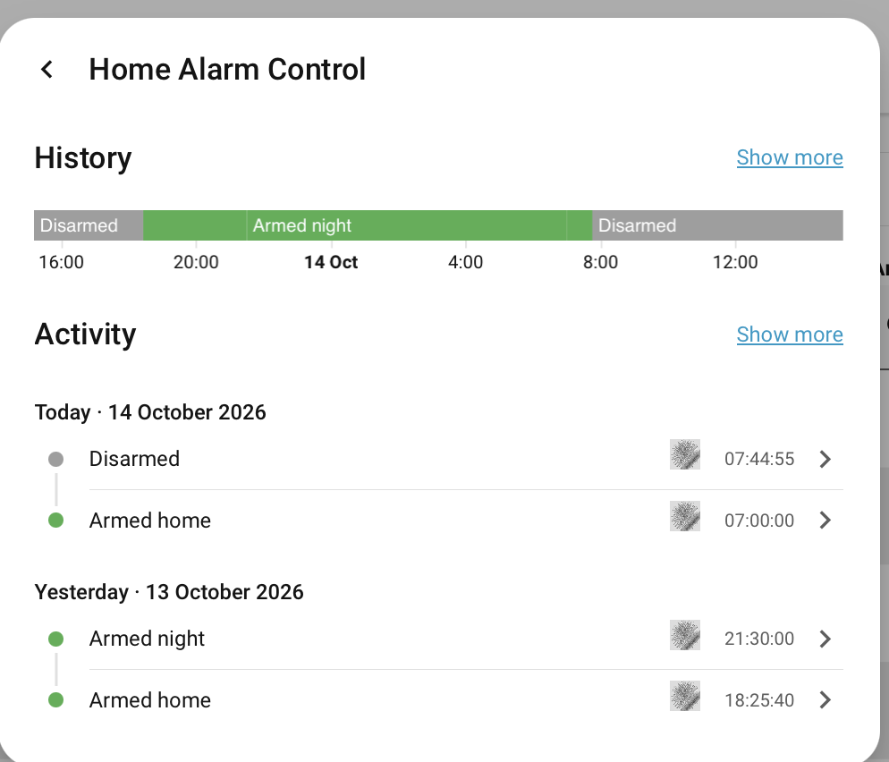
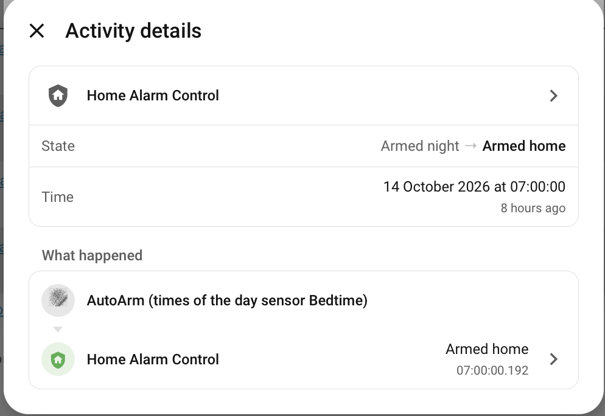
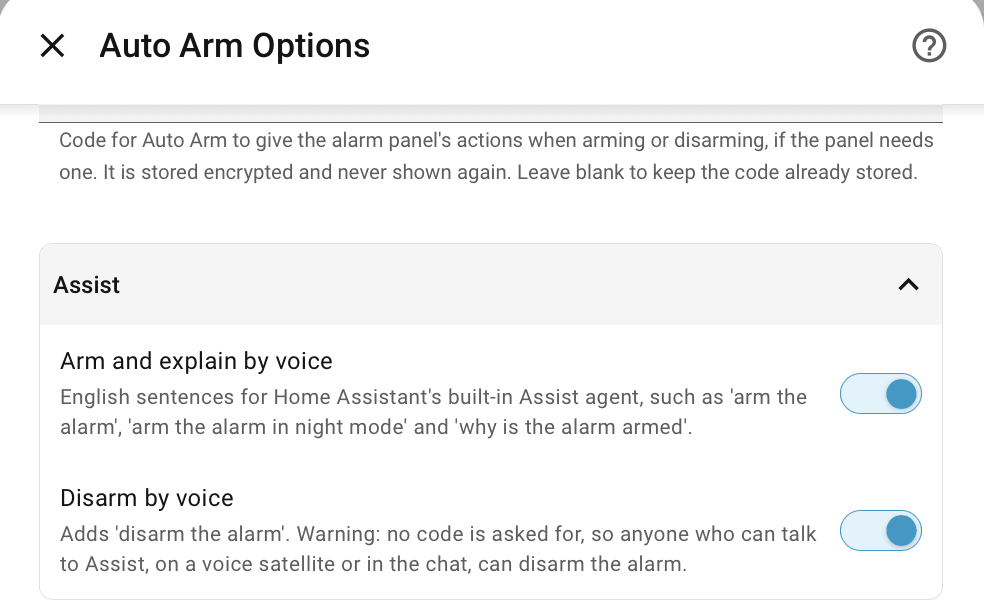
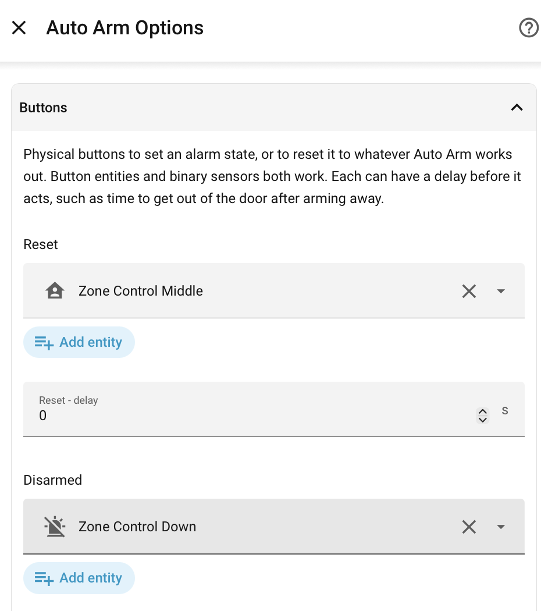
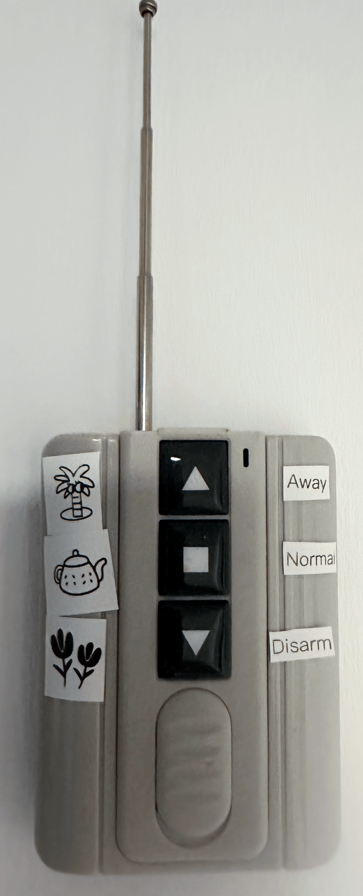
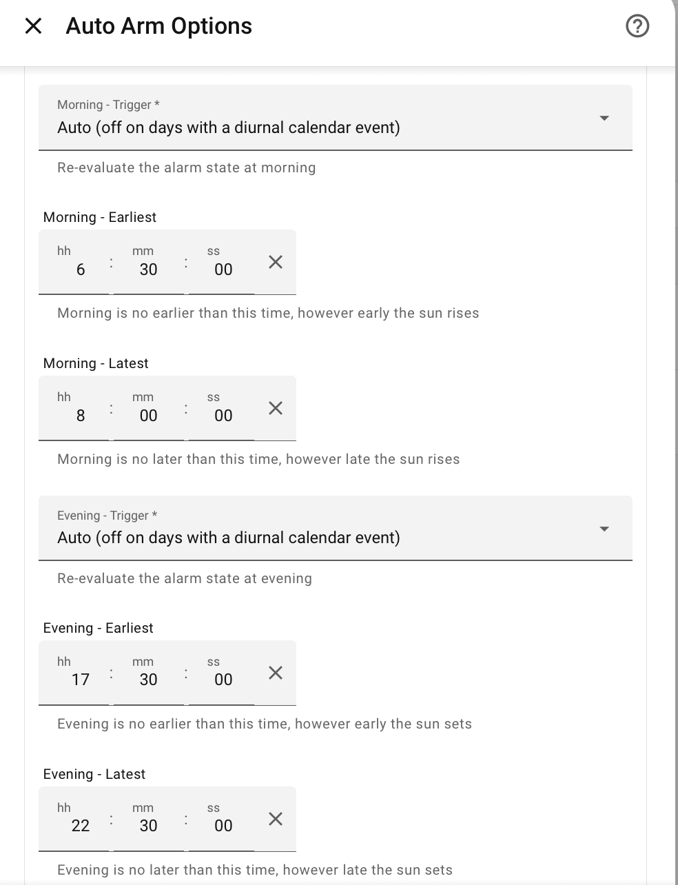
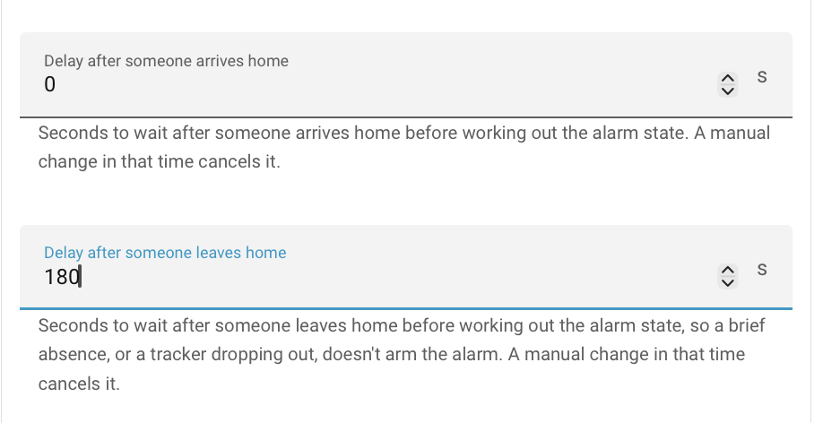

# Automated Arming

Arming has several complementary modes of operation, that can be selected and mixed as you need.

Mobile Actions, Buttons and Alarm Panel changes are classed as **Manual Interventions**, and won't be overridden back by Auto Arm unless there's an occupancy change or other manual intervention.

## Context

Here is a quick reminder of how Home Assistant intends armed states to be used, taken from the [Alarm Control Panel Documentation](https://www.home-assistant.io/integrations/alarm_control_panel/):

| State                 | Use                                                                                                                                                      |
|-----------------------|----------------------------------------------------------------------------------------------------------------------------------------------------------|
| `armed_home`          | Perimeter protection while you are inside. Doors and windows are monitored, but interior motion sensors are ignored so you move freely around the house. |
| `armed_away`          | Full protection for when nobody is home. All sensors (perimeter and interior) are active.                                                                |
| `armed_night`         | Similar to home mode, but tuned for sleeping. Typically covers perimeter sensors and selected interior zones while leaving bedroom areas free.           |
| `armed_vacation`      | Extended away protection for longer trips. Some systems enable additional monitoring or alerts in this mode.                                             |
| `armed_custom_bypass` | rmed with one or more zones deliberately skipped. Useful when you want to leave a specific door or window open while arming the rest of the system.      |
| `disarmed`            | The alarm is off. Sensors are not being monitored.   |

(There are also some other ephemeral or problem states needed for dealing with real alarm systems).

## How Alarm Panel State Gets Changed

The full list of how alarm panel state can be set:

| Source        | Description                                                               |
|---------------|---------------------------------------------------------------------------|
| calendar      | Calendar events (with optional override for selected events by occupancy) |
| tod           | A Times of the Day sensor turning on or off, such as a daily bedtime      |
| mobile        | Mobile action                                                             |
| occupancy     | Occupancy calculation, e.g. automatically switching off `ARMED_AWAY`      |
| alarm_panel   | Changes made to Alarm Control Panel outside of Auto Arm                   |
| button        | A physical button push                                                    |
| action        | A Home Assistant Action call (previously known as 'Service')              |
| sunrise       | HomeAssistant `sun` integration event                                     |
| sunset        | HomeAssistant `sun` integration event                                     |
| startup       | Alarm changes made as part of Auto Arm startup                            |
| zombification | Home Assistant alarm panel got itself into a 'zombie' state and was reset |

All the state changes are tracked back to Auto Arm as the reason, and where possible back to the original cause.

{width=400}
{width=400}

## Putting into Practice

So a typical day, when the house is occupied, using the [recommended recipe](configuration/examples/recommended_recipe.md) could be:

- Wake up (`armed_night`->`disarmed`)
  - Sunrise is ignored in this example, either its before you wake up and its still bedtime, or its after you wake up and the alarm already disarmed
- Sunset (`disarmed`->`armed_home`)
- Go to sleep (`armed_home`->`armed_night`)

Of course, in some latitudes, the sun might set after bedtime, or not rise until after woken up. Auto arm will cope with any combination of how you want it to be, with the help of the `sun` entity in Home Assistant driving sunrise and sunset times, calendar entries and a Times of the Day sensor. You can also integrate physical buttons, for example to arm before leaving the house.

## Alarm Panel Control

Auto Arm listens for changes to the Alarm Control Panel from other sources, like the Home Assistant mobile companion
app or other automations, with Auto Arm respecting the selected new state, and applying the same *Manual Intervention* controls for further state changes.

### Voice Assistants

The Home Assistant **Alarm Control Panel** can also be exposed to a Voice Assistant, so disarm or arm by talking to Alexa or similar. Use the *Settings*->*Voice Assistants* page in Home Assistant to do this.

Alexa has additional controls to prevent unauthorized disarming ( otherwise burgulars could shout
through the letterbox! ), see [Connect Your Home Security System to Echo Hub](https://www.amazon.co.uk/gp/help/customer/display.html?nodeId=T3hgRgU3Wx5DZxfZCB) on the Amazon documentation.

### Built-in Agent Sentences

!!! warning "Early Access"
    Limited to English. Feedback, and suggested wording for other languages, is welcome on
    [GitHub issues](https://github.com/rhizomatics/autoarm/issues).

Home Assistant's own [Assist](https://www.home-assistant.io/voice_control/) agent, which doesn't use AI, matches fixed sentences. Auto Arm adds these sentences, which work by voice or in the chat. Arming, explaining and help are on unless **Arm and explain by voice** is switched off in the **Assist** section of the Auto Arm options. Disarming is off unless **Disarm by voice** is switched on.

{width=500}

| Say                                  | Does                                            |
|--------------------------------------|-------------------------------------------------|
| "Arm the alarm"                      | Arms away                                       |
| "Arm the alarm in *home* mode"       | Arms *home*, *away*, *night* or *vacation*      |
| "Set the security system to *night*" | The same, "holiday" also works for vacation     |
| "Disarm the alarm"                   | Disarms, only if **Disarm by voice** is on      |
| "Why is the alarm armed?"            | Says who or what last changed it, when, and why |
| "What changed the alarm?"            | The same                                        |
| "How do I get help on Auto Arm?"     | Gives the link to this documentation            |
| "I need help with Auto Arm"          | The same                                        |

"Alarm", "security system" and "burglar alarm" all work. These sentences take priority over Assist's own alarm sentences, so arming or disarming by voice goes through Auto Arm and counts as a *Manual Intervention*, like a button.

Asking why gives the time of the change and what made it, such as a calendar event, sunset, a button or someone leaving. For changes worked out from who's home and the time of day, it also says whether anyone was home and whether it was night. Changes made directly on the alarm panel are reported as such. Auto Arm only knows about changes since Home Assistant last started.

!!! danger "Disarming by voice"
    With **Disarm by voice** on, anyone who can talk to Assist can disarm the alarm, and no code is asked for. Think about who can reach your voice satellites and chat before switching this on.

## Physical Button Control

Handy if you have a Zigbee, 433Mhz or similar button panel by the door - choose one of the
[Button Integrations](https://www.home-assistant.io/integrations/?cat=button) entities
for `DISARMED`,`ARMED_AWAY` etc, or a *Reset* button to set the panel by the default algorithm.

Two kinds of entity work as buttons:

- **Button entities**, such as `button` or `input_button`, whose state is the time of the last press, so each new time is a press
- **Binary sensors**, such as a door-side remote, where turning `on` is a press, and turning back `off` is ignored

A button going `unavailable`, `unknown` or coming back online isn't treated as a press, so a remote reconnecting won't change the alarm. On/off switches, where `off` should mean something of its own, aren't supported.

Buttons are chosen in the **Buttons** section of the options, with any number for each alarm state and for *Reset*.

A delay in seconds can be set for each, so if for example you have an *away* button next to the front door, you can give yourself a couple of minutes to exit the property before the alarm is set. The delay is zero unless set, other than for `armed_away`, which starts at 120 seconds.

{width=500}

See also the [Manual MQTT Alarm Control Panel](https://www.home-assistant.io/integrations/manual_mqtt/)
for another way to integrate physical buttons to control state.

{width=240,align=left}
/// caption
Example Cheap 433Mhz Buttons Using RFLink
///

## Mobile Action Control

This works similar to the buttons, except its driven by [Actionable Notifications](https://companion.home-assistant.io/docs/notifications/actionable-notifications/). See [Mobile Actions](configuration/mobile_actions.md) for more information, and the [Contextual Mobile Actions Recipe](https://supernotify.rhizomatics.org.uk/recipes/contextual_mobile_actions/) for a nice way to do this in [Supernotify](https://supernotify.rhizomatics.org.uk) where only the appropriate actions are shown.

These can be added to any notification, so for example noisy PIR alerts can be quickly squelched by disarming the alarm.

## Home Assistant Action

An action (aka "service") called `autoarm.reset_state` can be used to trigger a state reset. It will work
the same way as other resets, such as at sunrise or sunset.

## Calendar Control

!!! note "Configuration split"
    Calendar entities are configured via the Auto Arm **Options** UI. Its **Advanced - Calendar** section has what happens when an event ends, the match rules for which events set which state, the poll interval and the notification grace period. Any of these still in YAML are copied into the options the first time.

### Integrating a Calendar

Use a Home Assistant [calendar integration](https://www.home-assistant.io/integrations/?cat=calendar) to
define when and how to arm the control panel. If you don't have one, follow these [instructions](configuration/create_calendar.md).

Using a [Remote Calendar](https://www.home-assistant.io/integrations/remote_calendar/), [Google Calendar](https://www.home-assistant.io/integrations/google/) or similar also means that alarm scheduling can be done remotely, even if you have no remote access to Home Assistant.

Multiple calendars, of different types, can be configured, and specific alarm states / match patterns per calendar. See the [example configuration](configuration/examples/typical.md)

### Recurring State

Armed or disarmed state can be configured with an entry for that purpose, for example a recurring entry on a [Local Calendar](https://www.home-assistant.io/integrations/local_calendar/) dedicated to Auto Arm, or looking up an existing calendar to find vacations by pattern.

If there's no calendar event live, then arming state can be worked out automatically, fixed at a default state, or left to manual control.

## Times of the Day Control

A [Times of the Day](https://www.home-assistant.io/integrations/tod/) sensor can set an alarm state for the same period every day, without needing a recurring calendar event. For example, a **Bedtime** sensor that is on from 23:00 to 07:00 holds the alarm at `armed_night`, whatever time the sun sets or rises. See the [Recommended Recipe](configuration/examples/recommended_recipe.md) for a complete setup with sunset and a vacation calendar.

1. Create the sensor in **Settings** > **Devices & Services** > **Helpers** > **Create Helper** > **Times of the Day**, giving the times it turns on and off.
2. In **Settings** > **Devices & Services** > **Auto Arm** > **Configure**, choose it as the **Bedtime - Times of the Day Sensor**, or for any other alarm state, open the **Advanced - Times of the Day Sensor** section and choose the sensor for the state it should set. More than one sensor can be chosen for a state. There's no choice for `armed_vacation`, as a daily period doesn't suit it.

While the sensor is on:

- The alarm goes to the sensor's state when it turns on, including when Home Assistant starts part way through the period.
- Automatic resets, such as sunrise or sunset, leave the state alone, along with any manual change made meanwhile. A reset button or the `autoarm.reset_state` action returns to the sensor's state.
- If everyone is out, the alarm is `armed_away` instead, and goes to the sensor's state when someone comes home, and back to `armed_away` if they all leave again. This applies to the states chosen under **Advanced - Occupancy** in the options, which by default is all but `armed_custom_bypass`.
- A live calendar event takes priority. The sensor turning on or off during the event changes nothing, and if the sensor is still on when the event ends, the alarm goes to the sensor's state. So there's no need to switch a bedtime sensor off for a vacation that's in the calendar.

When the sensor turns off, becomes unavailable or is removed, the period ends and the [calendar event end settings](configuration/advanced_config.md#when-an-event-ends) decide the new state. **Auto** here means **By occupancy**, other than for a [bedtime](#bedtime) sensor, where it's worked out from occupancy and the sun.

### Bedtime

A sensor chosen for `armed_night` is a bedtime sensor, and makes `armed_night` strictly for bedtime, whenever that is. It can be any time of day or night, such as for a shift worker, and there's nothing to choose about how it behaves:

| When                                          | What happens                                                                                    |
|-----------------------------------------------|-------------------------------------------------------------------------------------------------|
| Bedtime starts, with someone home             | `armed_night`, whether or not the sun is up                                                     |
| Sunrise or sunset during bedtime              | Ignored                                                                                         |
| Bedtime ends with the sun up                  | Worked out as usual from occupancy and the sun, so the daytime state                            |
| Bedtime ends in the dark                      | The state for between bedtime and morning, and worked out again at sunrise                      |
| Everyone is out                               | Bedtime is ignored, and the alarm stays `armed_away`                                            |
| Someone comes home during bedtime             | `armed_night`, as if bedtime had just started                                                   |
| Everyone leaves during bedtime                | `armed_away`, until someone is back                                                             |

None of this overrides a live calendar event. The states either side of bedtime are set in the **Advanced - Diurnal** section of the options, see [Diurnal Control](#diurnal-control).

Whether the dark is before or after bedtime goes by whether a bedtime sensor has turned off since the sun last set. That isn't known after a restart, when the dark is taken to be before bedtime.

Changes made by a Times of the Day sensor have the `tod` source, for notification profiles and in the logbook, and are linked to the sensor's own state change.

## Triggers

Triggers decide what can start a re-evaluation of the alarm state. They change *when* the state is worked out, not *how*, and only cover these triggers - a reset button, the `autoarm.reset_state` action or a calendar event ending still work out the state as usual.

| Trigger                  | Options section          | Choices       | Default |
|--------------------------|--------------------------|---------------|---------|
| **Sunrise**              | **Advanced - Diurnal**   | On, Off, Auto | Auto    |
| **Sunset**               | **Advanced - Diurnal**   | On, Off, Auto | Auto    |
| **Someone arrives home** | **Advanced - Occupancy** | On, Off       | On      |
| **Someone leaves home**  | **Advanced - Occupancy** | On, Off       | On      |

**Auto** switches the trigger off on any day with a `disarmed`, `armed_home` or `armed_night` [Calendar Control] event starting, ending or running that day, since those events replace day and night arming. Events for other states, such as `armed_away` or `armed_vacation`, leave the trigger on. This suits a calendar that handles particular days, such as a night out or working from home, while sunrise and sunset take over on ordinary
days.

Every arrival or departure re-evaluates, not just the house becoming occupied or empty, since [Transition Conditions](configuration/advanced_config.md#algorithm-conditions) can depend on who in particular is home. When that doesn't change the alarm state, nothing happens.

## Diurnal Control

This does three things to support [Automated Transitions]:

1. Re-evaluate the alarm state at **sunrise**
    - There's a `earliest` and `latest` cutoff option in the UI config to stop alarm being disarmed at 4am if you live far North, like Canada or Scotland.
    - The cutoffs for sunrise can be set to the same time to override the `sun` integration altogeher for sunsrise
2. Re-evaluate the alarm state at **sunset**
    - There's a `earliest` and `latest` cutoff option in the UI config, which works identically to that for sunrise
3. Provide a `day` and `night` value for conditions

These are in the **Advanced - Diurnal** section of the options, where **morning** is sunrise kept within its earliest and latest times, and **evening** is sunset kept within its own.

Day is from morning to evening, and night from evening to morning, for everything that works out the state, not only the triggers. So with an earliest morning of 06:30, someone arriving home at 05:00 in midsummer daylight still gets the state for the night.

Whether morning and evening re-evaluate the alarm state at all is set by their [Triggers]. Switching them off there doesn't change the `day` and `night` values, so these still choose between armed states whenever the
state is worked out for some other reason.

The same section has the states for when someone is home:

| Setting                                        | Default      | When                                                                   |
|------------------------------------------------|--------------|------------------------------------------------------------------------|
| **Occupied state between morning and evening** | `disarmed`   | Daytime                                                                |
| **Occupied state between bedtime and morning** | `armed_home` | The dark after a [bedtime](#bedtime) sensor turns off, until sunrise   |
| **Occupied state between evening and bedtime** | `armed_home` | From sunset until bedtime                                              |

If nothing sets `armed_night` for bedtime that day, neither a bedtime sensor nor an `armed_night` calendar event, there's no bedtime to wait for and it's `armed_night` from evening.

Sunrise and sunset are acted on as day and night as they happen, without waiting for the `sun` entity to change state.

A sunrise before the earliest time is held back until then, and the latest time is morning even if the sun isn't up yet. Starting Home Assistant in between leaves it as night, with morning still to come at the earliest time.

A change held back like this, or by an occupancy or button delay, is shown as deferred from its source, such as `deferred from sunrise`, in the logbook and the **Last calculation** sensor.

{width=500}

## Occupancy Control

The people who live at the property can be defined as [Person Integration][] entities [Person Entities]() in the `occupancy` configuration, and used to derive an `occupied` value for [Automated Transitions]. This works best with the Companion App on a mobile phone, although other [Device Tracker Integrations](https://www.home-assistant.io/integrations/?cat=device-tracker)
can work, such as a home network `device_tracker`.

!!! tip
    Since the occupied check looks for entities that have a state `home`, it doesn't have to be `person` entities, and you can add a list of `device tracker` entities.
    The advantage of Person is that you can define multiple trackers for a single individual, and they are `home` if any of the trackers are `home`, even if some of them haven't kept up.

See the [Presence Detection](https://www.home-assistant.io/getting-started/presence-detection/) guidance from Home Assistant on how to set this up, and the options for using it.

If the house is occupied, and its daytime, some people like that to be `disarmed` and others prefer `armed_home`. You can control this via [Calendar Control][] or use the `state_default` settings for day and/or night in the `occupancy` configuration.

One problem with device trackers is that they can be noisy, for example if someone tracked by phone walks out of wifi range, or reboots their device. This tends to be a problem when building occupied, since its much less likely for a device tracker to intermittently think the device is at home. A delay timer can be set, separately for `home` and `not_home`, to smooth this out, so alarm won't reset unless someone still out a few minutes later.

In this *Advanced Settings* configuration, there will be a three minute wait to make sure the device tracker stable for `home`->`not_home`, and zero delay when arriving home.

{width=500}

Occupancy checks can override recurring calendar driven alarm states if desired. In the configuration screen, select the
alarm states for which the calendar state should be overridden. This means you can have a simple repeating `disarmed`
/ `armed_night` calendar setup but still have the alarm automatically go to `armed_away` if everyone leaves home.

Separately, the **Coming home ends away and vacation events on their last day** switch, in the same
**Advanced - Occupancy** section, lets an arrival finish an `armed_away` or `armed_vacation` event early.
It's on by default. When someone comes home on the day the event is due to end, the event ends
there and then, and the alarm goes to whatever is set for [when an event ends](configuration/advanced_config.md#when-an-event-ends), so getting back
from a trip a few hours ahead of the calendar doesn't mean walking into an armed house. It applies to one-off as well as recurring events.
It takes someone actually arriving that day, a change from away to home, so a person who is always shown as home, for example without
location sharing switched on, doesn't end the event.
An arrival on any earlier day of the event leaves the alarm armed, and an all day event's last day is the last full day it covers.

[CalendarEvent]: https://github.com/home-assistant/core/blob/56a71e6798ada65e9c99f92f64bd4168e98b935b/homeassistant/components/calendar/__init__.py#L364
[Alarm Control Panel Integrations]: https://www.home-assistant.io/integrations/?search=alarm+control+panel
[Conditions]: https://www.home-assistant.io/docs/scripts/conditions/
[HACS]: https://hacs.xyz
[Button Integration]: https://www.home-assistant.io/integrations/button/
[Person Integration]: https://www.home-assistant.io/integrations/person/
