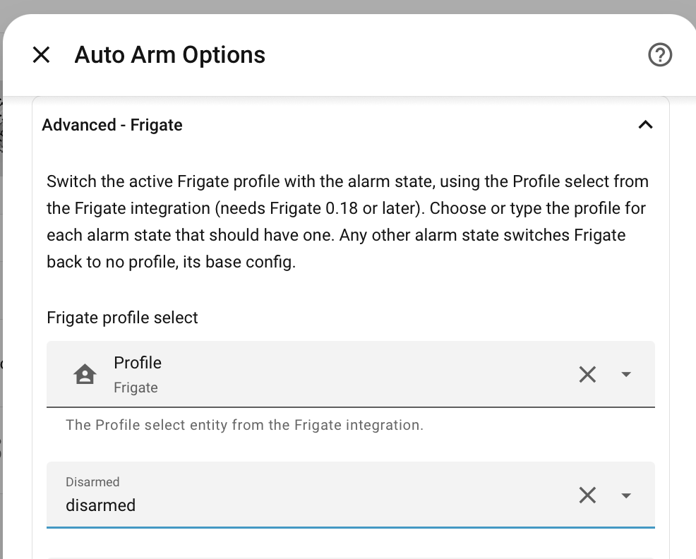

# Frigate Profiles

Auto Arm can switch the active [Frigate Profile](https://docs.frigate.video/configuration/profiles/) as the
alarm state changes. For example, your cameras could record and send notifications only while the alarm is
`armed_away`, or skip detection on indoor cameras while `disarmed`.

{width=500}

This needs Frigate 0.18 or later, and the [Frigate integration](https://docs.frigate.video/integrations/home-assistant/),
which provides a **Profile** select entity once at least one profile is defined in Frigate.

## Set up the Profiles in Frigate

!!! tip
    Profiles can be configured in Frigate's web based [Settings UI](https://docs.frigate.video/configuration/config/#using-the-settings-ui) as well as directly in YAML.

Profiles named after alarm states are matched up automatically, so naming them that way needs no
further setup in Auto Arm:

```yaml
profiles:
  disarmed:
    friendly_name: Disarmed
  armed_away:
    friendly_name: Away

cameras:
  living_room:
    profiles:
      disarmed:
        detect:
          enabled: false
```

Profiles can only override what's already in the base config. See the Frigate docs for the constraints,
such as recording having to be enabled in the base config.

## Configure Auto Arm

When the Frigate integration has a Profile select, Auto Arm's setup and Options show
**Frigate - Switch Profiles with the Alarm State**. Switch this on, and each alarm state is matched to a
Frigate profile by name, ignoring case:

| Frigate profiles         | Alarm state   | Profile used  |
| ------------------------ | ------------- | ------------- |
| `Disarmed`, `armed`      | `disarmed`    | `Disarmed`    |
| `Disarmed`, `armed`      | `armed_away`  | `armed`       |
| `armed`, `armed_night`   | `armed_night` | `armed_night` |
| `armed`, `armed_night`   | `armed_home`  | `armed`       |
| `quiet`                  | `armed_home`  | no profile    |

A profile named `armed` covers all the armed states, unless one has a profile of its own name.

### Overriding the Matches

The **Advanced - Frigate** section of the Options is only needed to change the matches:

- **Frigate profile select**: only needed with more than one Frigate server, otherwise the Frigate integration's
  Profile select is found automatically
- a profile for each alarm state, filled in with the profile matched by name, to change to another of
  Frigate's profiles, or one typed in

Clear a state, or choose **No profile**, to keep Frigate on its base config for that state. Once the Options are
saved, the profiles are kept as they are, so a state cleared isn't matched again, and a profile added to Frigate
later is only matched when chosen in the Options.

Whenever the alarm panel moves to a state with a profile, whatever changed it, Frigate is switched to that
profile. Any other alarm state switches Frigate back to no profile, so the cameras use their base config.

Some states leave the profile as it is:

- transitional states, like `arming`, `pending` and `triggered`
- an alarm panel that is unavailable

Auto Arm also brings Frigate up to date when Home Assistant starts, and when the Profile select becomes
available again after Frigate has been offline. It doesn't switch back a profile you choose by hand in Frigate.
It only changes the profile again when the alarm state next changes.

If the profile given for an alarm state isn't in Frigate, Auto Arm logs a warning and switches Frigate
back to no profile, its base config.
