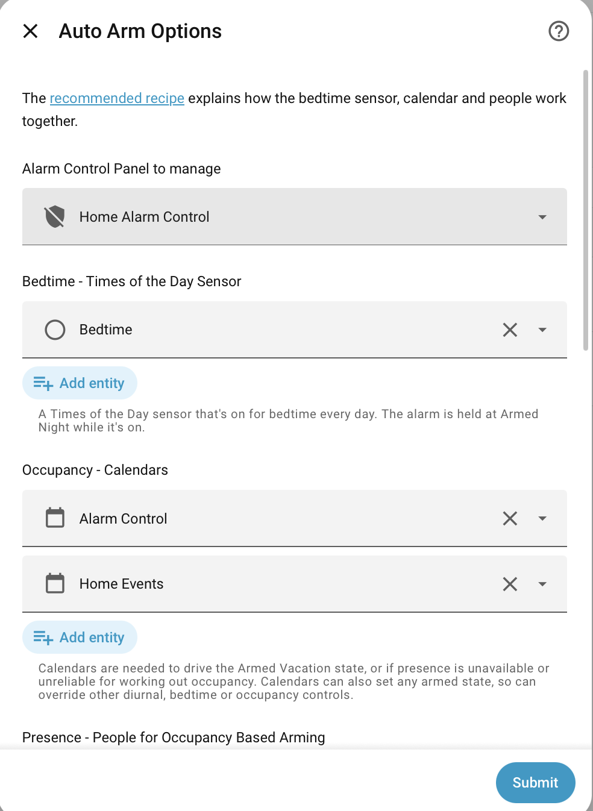

# Quick Start

Auto Arm is one of the default repositories on [HACS][], so there's no need to register a custom repo.

Notifications will work with any HomeAssistant notification implementation, with additional support for [Supernotify](https://supernotify.rhizomatics.org.uk) for multi-channel notifications with mobile actions.

## Configuration

Auto Arm is set up using the Home Assistant Integrations page, with additional advanced configuration available via YAML.

### UI Setup

1. Go to **Settings** > **Devices & Services** > **Add Integration** and search for **Auto Arm**.
2. Select your **Alarm Control Panel** entity (any [Alarm Control Panel Integration][Alarm Control Panel Integrations] will work). If you don't have one, see [Create an Alarm Panel](configuration/create_panel.md).
3. Optionally select a **Bedtime sensor**, **Calendar** and **Person** entities, as used by the [recommended recipe](configuration/examples/recommended_recipe.md). Everyone known to Home Assistant is selected to start with.
4. Adjust defaults in **Options** at any time (calendar entities, person entities, times of the day sensors, triggers, occupancy defaults, calendar end modes).

### Typical Day / Night

There's a recommended [recipe](./configuration/examples/recommended_recipe.md) to follow for a classic alarm setup:

- `ARMED_NIGHT` at bedtime
- `DISARMED` during the day
- `ARMED_HOME` between sunset and bedtime.
- `ARMED_AWAY` if nobody home
- `ARMED_VACATION` if away on holidays

If that's not quite how you like, its still a good starting place for an easy to configure, zero YAML, low maintenance setup.

[Alarm Control Panel Integrations]: https://www.home-assistant.io/integrations/?search=alarm+control+panel

## Frigate

Set up [Frigate Profiles](https://docs.frigate.video/configuration/profiles/) for the alarm states you want to tune the configuration.

Easiest thing is to create a `disarmed` profile to reduce noisy alerts. Switch on Frigate integration in the Auto Arm integration settings.

More on how to configure and use it at [Frigate Profile Switching](configuration/frigate.md).
